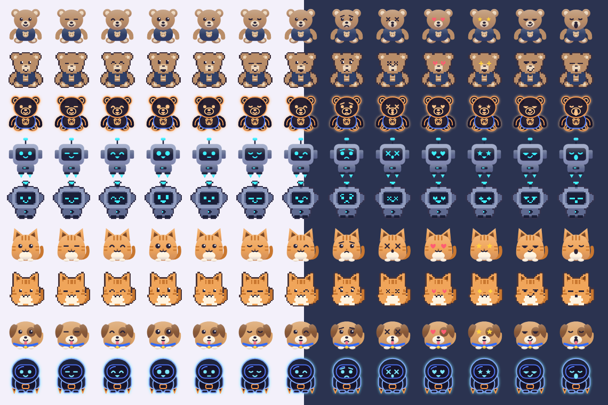
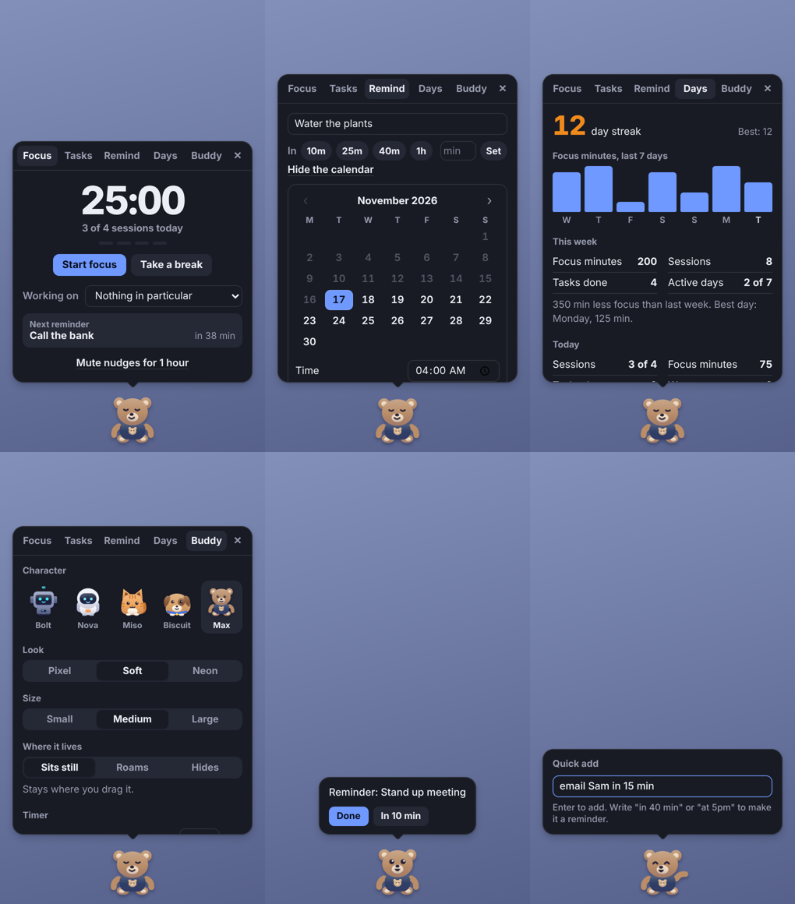

# Deskling

A tiny figurine that lives on your desktop and keeps you on track. Windows, macOS and Linux.



## Try it

**[Open the live demo](https://deskling.vercel.app)** in your browser, no install needed. If you like it, a star helps.

## What it does

- **Focus timer** – Pomodoro sessions with short and long breaks. The countdown sits under the buddy.
- **Tasks** – a short list for today, plus "the one thing" that would make the day a win.
- **Reminders** – "remind me in 40 min", or pick a date and time on the built-in calendar. Once, every day, or weekdays.
- **Quick add** – press Ctrl + Alt + Space anywhere and type `buy milk` (a task) or `call mom in 40 min` (a reminder).
- **Wellbeing nudges** – water, stretch, eye rest, posture. They wait until your focus session ends.
- **Days** – streak, focus minutes for the last 7 days, this week against last week, and a Sunday report you can copy.
- **5 buddies × 3 looks** – Bolt the robot, Nova the astronaut, Miso the cat, Biscuit the dog and Max the teddy, each in pixel, soft or neon.
- **13 expressions** – they blink, wink, yawn, get dizzy, get starry-eyed when you finish a task, and look sad if you quit a session.
- **3 ways to live on screen** – sits where you drag it, roams the bottom of the screen (walking, running, or hovering on jets if it is a robot), or hides in the tray and pops out only for reminders.
- **Update check** – tells you when a newer release is out and opens the download page.

Click the buddy to open the panel. Drag it to move it. Right-click it for a trick. Its eyes follow your pointer.



## Why it is light

- Built on [Tauri](https://tauri.app): it uses the webview your OS already ships instead of bundling a browser. The Windows installer is about 1 MB.
- One small window that is only ever as big as what is on screen.
- No framework, no bundler, no image files. Characters are drawn from a few dozen lines of shape data each.
- The page runs no timers of its own while idle; the shell sends one tick a second.

## Your data

Everything is stored on your own computer, in the app's local storage. There is no account and no server. History is kept for a year. The only network request Deskling makes is the once-a-day update check to GitHub, which you can turn off under Buddy. "Copy all my data" under Days gives you a JSON copy.

## Install

Download the installer for your system from the [latest release](https://github.com/Abhiram-awsd/Deskling/releases/latest).

The builds are not code-signed yet, so the first launch needs an extra step:

- **Windows** – on the blue "Windows protected your PC" box, click **More info**, then **Run anyway**. If Smart App Control blocks it outright, it has to be turned off under Windows Security > App & browser control.
- **macOS** – open System Settings > Privacy & Security and click **Open Anyway**. If it says the app is damaged, run `xattr -cr /Applications/Deskling.app` in Terminal.

## Build from source

You need [Rust](https://rustup.rs), [Node.js](https://nodejs.org) and the
[Tauri system prerequisites](https://tauri.app/start/prerequisites/) for your OS.

```sh
npm install
npm run dev      # run it
npm run build    # make an installer in src-tauri/target/release/bundle
```

To work on the look and feel only, open `src/index.html` in a browser. Everything except window movement works there.

## Releases

Bump the version in `package.json`, `src-tauri/tauri.conf.json` and `src-tauri/Cargo.toml`, push, then run the **Release** workflow from the Actions tab. It builds installers for all three systems and publishes them as release `v<version>`, which is what the in-app update check looks for.

## Layout

```
src/characters.js   the figurines and the three renderers
src/app.js          timer, tasks, reminders, stats, panel
src/shell.js        bridge to the desktop shell (no-ops in a browser)
src/style.css       all styling
src-tauri/          the Rust shell: window, tray, heartbeat
```

Want to add a character? See [CONTRIBUTING.md](CONTRIBUTING.md).

## License

MIT
